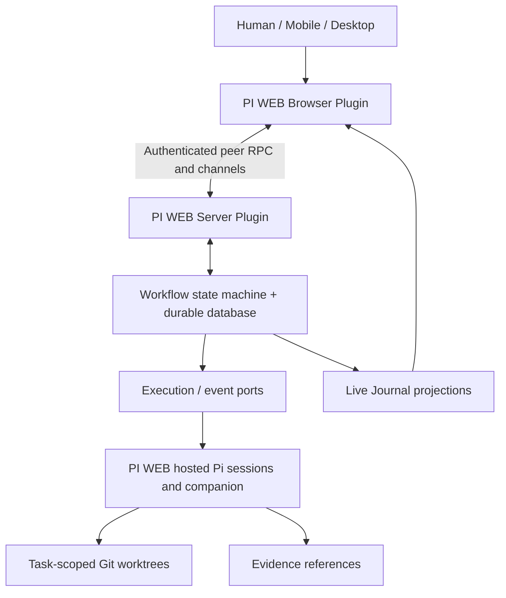

# ADR-0001: Human-steerable control plane on Pi and PI WEB

- Status: Accepted for initial architecture (implementation evolves through PRs)
- Date: 2026-10-09
- Scope: pi-micromanager

## Context

Multi-Agent-Shogun's strongest property is the ability to watch **all** agents side by side and intervene directly in any one, without routing human input through a manager agent. Its hierarchical role instructions and launch-directory conventions, however, consume context and impose framework-specific behavior on model prompts. The project needs continuous upstream maintenance, provider flexibility, worktree isolation, strict DAGs, structured QC, graphical journals, and phone access. TTS is deliberately the **last priority**.

The product is **pi-micromanager**, "A human-steerable control plane for Pi agent swarms." The tagline is "See everything. Hear everything. Steer anything. Welcome to Cognitive Overload!" Here "everything" means all observable/authorized activity, **not** hidden model chain-of-thought.

## Decision

1. Use upstream **Pi** for the model/agent loop, credential handling, providers, session state, and extension events. Do not emulate the agent loop or copy a large role hierarchy into `AGENTS.md`.
2. Use upstream **PI WEB** as the existing host for persistent sessions, multi-project/workspace navigation, browser access, file/terminal handling, and a browser/server plugin extension surface. Start with the public Browser API v4 / Server API v3; pin and verify actual installed versions.
3. Own a **small deterministic workflow control plane** whose inputs/outputs are typed data: DAG templates, task attempts, QC decisions, versioned amendments, role admission, and evidence references. This is **not** another LLM. The control plane must function even when the planner's context is compacted.
4. Keep the control plane behind abstract execution/observation interfaces; the first future adapter will target Pi/PI WEB, but orchestration semantics must not import Pi/PI WEB types. A provider's model ID and its actual authentication must remain separate concerns. The host handles Sign in with ChatGPT or other authentication; do not store OAuth tokens in MAMC.
5. Preserve Shogun's flat human-override UX. Agent parents and delegations may exist for execution, but **every observed agent has a direct human control target**. Never require routing the user's messages through Sol.
6. Prefer additive packages over forks: PI WEB browser plugin for panels; PI WEB server plugin for workspace-scoped communication; Pi companion extension for model configuration and exported activity when its bridge exists; independent process for long-lived scheduling once reliability requires it.
7. No TTS in the first milestones. Voice personas and Swarmfield are UI presentation concerns, not model identity or extra role prompts.

## Components and boundaries

- Browser tabs: Cockpit / DAG / Kanban / Journal. Workspace-scoped records; application-level overview later.
- Core owns **state, not raw transcript replication**. Observe actual Pi messages/tools where permitted, and persist selected event summaries and immutable evidence references.
- Workspace isolation is mandatory for concurrent writers. `pi-sessions` v1 can create/run an agent in an **existing** workspace but does not itself provision an independent worktree or expose per-launch model/effort parameters. Do not claim production parallel-safe execution until that provisioner and model setup handshake are implemented.
- PI WEB public `pi-session-events` is session-local communication **without guaranteed replay or delivery acknowledgment**. Message receipt/completion must be explicitly acknowledged and durable; uncertain command delivery must not be retried blindly.
- Application/workspace panels are PI WEB's standard tab surfaces, not guaranteed app-wide fullscreen. Validate layout before promising a Shogun-equivalent grid at full desktop width.

## Autonomy versus authority

- Sol low proposes tasks and amendments, but **cannot directly mutate running state** by editing YAML or instructing other agents to bypass gates.
- A human submits authoritative interventions that become durable control-plane commands **immediately**, independently of Sol availability.
- Workflow admission and execution are validated by code. Only active leases and approved transitions permit the next attempt. Failed checks cannot be overturned by an agent's final prose.
- Provider-driven tool output never becomes a privileged instruction; no hidden prompt-injection bypass of admission, credentials, or file ownership.

## Alternatives considered

- **Keep modifying Multi-Agent-Shogun**: preserves tmux grid, but prolongs custom orchestration/role instructions and maintenance obligations.
- **Codex CLI-only rewrite**: enables ChatGPT login, but hardcodes provider protocol, model control and session semantics.
- **Fork PI WEB immediately**: faster fullscreen experiments, but makes every upstream upgrade expensive.
- **Pi subagents only**: useful local parallelism, but no persistent hard DAG gate or full-grid UX by default.

## Consequences

- Benefits: smaller agent context, maintained host/runtime, flat direct-control design, testable deterministic workflow.
- Costs: PI WEB plugin surface is narrower than the host's own UI; live per-agent streams, arbitrary-session steer, worktree lifecycle, crash recovery and hard repository merge gates require additional work.
- In v0.1 the UI is a **workflow simulator**. It does not launch or steer Pi agents yet. Do not present simulated states as live activity.

## Source references (2026-10-09)

- https://github.com/earendil-works/pi/tree/main/packages/coding-agent
- https://github.com/earendil-works/pi/blob/main/packages/coding-agent/docs/extensions.md
- https://github.com/jmfederico/pi-web/blob/main/docs/plugins.md
- https://github.com/jmfederico/pi-web/blob/main/src/plugin-api.ts
- https://github.com/jmfederico/pi-web/blob/main/src/server-plugin-api.ts
- https://github.com/yohey-w/multi-agent-shogun
