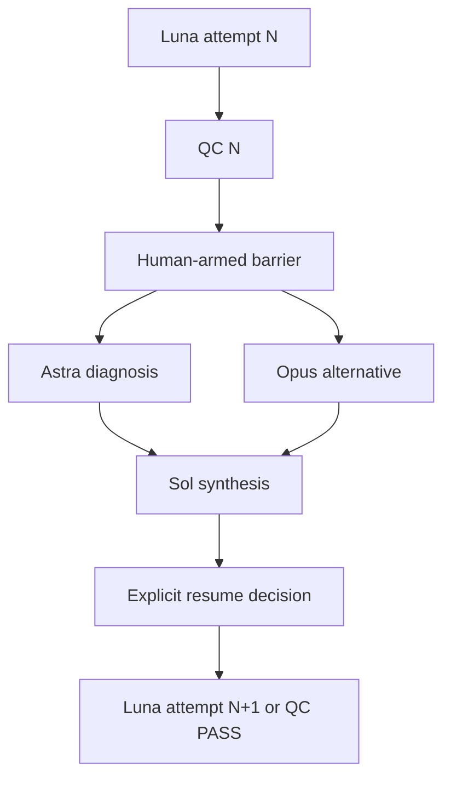

# ADR-0002: Versioned DAG, QC barriers, and runtime Workflow Amendments

- Status: Accepted (v0.1 subset implemented)
- Date: 2026-10-09

## Context

The user can intervene at any point: "Before the usual five implementation/QC exchanges are exhausted, after the **next QC** finishes, pause the next Luna rework, run independent Astra and Claude Opus diagnoses in parallel, then let Sol synthesize a new plan." A text prompt that asks Sol to remember such an instruction cannot safely serialize against a concurrent QC completion.

## Decision

**Template vs instance vs amendment:**

- `WorkflowDefinition`: Git-reviewable declarative task IDs, explicit dependency gates, default `maxQcRounds`, model-role intent and concurrency limits. Editable while **not executing**; a new template does not overwrite an active instance.
- `WorkflowInstance`: durable authoritative state with tasks, attempts, QC runs, revision, command receipts, and workflow events. The database is the source of truth during execution.
- `WorkflowAmendment`: versioned, scoped one-shot change to an instance. Register an `after_next_qc` barrier as soon as the human requests it; Sol can propose details without delaying barrier registration. Apply graph mutation only at a guarded transition.

**DAG** is a directed acyclic graph of task dependencies. **Workflow** is the state machine that admits tasks, reacts to QC, validates gates and publishes new ready nodes. Rework is a new attempt within the task, **not an edge back to a previous node**, so the graph remains acyclic.

## v0.1 state machine

- `blocked`: dependencies not fulfilled.
- `ready`: admission allowed if role capacity available.
- `running`: one claimed attempt, but v0.1 has no external executor/lease yet.
- `awaiting_qc`: implementation completed and test evidence bound to a commit SHA, criteria revision, and attempt.
- `held`: a human barrier has intercepted QC finalization; no automatic rework, integration or merge.
- `passed`: current implementation has a matching QC PASS.
- `integrated`: integration has been explicitly recorded (repository Git merge wiring is future work).
- `done`: diagnostic or synthesis task has finished.
- `needs_human`: automatic QC budget exhausted.

Dependency gates: `completed`, `qc_passed`, `integrated`, `qc_finalized`. The strict engine verifies references and acyclicity and grants `ready` only when each declared gate is satisfied. A QC PASS applies to a single `(headSha, criteriaRevision, attempt)`. A stale result fails closed.

## Human intervention execution

1. UI durably registers a command with `commandId`, target task, expected instance revision, target QC run ID (or the `next` sentinel), desired independent diagnostic agents, and author attribution (future audit extension).
2. Storage applies admission transactionally and rejects duplicate/conflicting commands. The target's next automatic transition is guarded at the same serialized boundary as QC finalization.
3. Once matching QC is **finalized** (QC agent settled, verdict/evidence persisted, matching SHA and acceptance revision), activate the barrier **before** emitting a new ready rework attempt.
4. Dynamically append two independent diagnosis nodes and a synthesis node depending on both. Both receive the same frozen evidence package; they should be read-only and initially not see each other's conclusions.
5. Synthesis completes and Sol proposes a revised plan. An explicit `resume_after_diagnosis` decision re-enables rework or accepts a previously passing QC. The QC budget is **not reset**.
6. Re-check all readiness/claims atomically before dispatch. Log the decision and links to evidence. The historical graph remains auditable.

## Invariants and failure behavior

- **No direct mutation of executing YAML by Sol.** Sol uses typed propose/apply commands, and versioned CAS rather than blind last-writer-wins.
- Command receipts are durable; replay of identical command ID is a no-op; conflicting payload with same ID is rejected.
- Acknowledge and persist an amendment even when Sol is busy. If QC completes before details are prepared, hold the target until the amendment has been resolved.
- No task auto-runs merely because its state becomes `ready`. The separate dispatcher must claim it under a lease and check capacity again. This allows manual inspection and control.
- QCs cannot approve unknown/new commits, stale criteria revisions or wrong attempts.
- Parallel implementation must have distinct worktrees. Never dispatch two modifying agents into the same shared workspace concurrently.
- If one diagnosis fails or disappears, do not silently treat the remaining opinion as a consensus. Do not auto-merge on incomplete evidence.
- If the PI WEB/companion transport disconnects between sending and receiving a reply, mark dispatch **uncertain** and reconcile via a durable session/task identity; do not blindly send again.
- A `held` workflow node requires explicit resolution and is never GC eligible.

## v0.1 versus remaining work

Implemented: validated static DAG, capacity limits, pure state transitions, bounded event journal, QC SHA/criteria/attempt binding, QC round budget, one-shot barrier, parallel diagnostic and synthesis nodes, explicit resume, SQLite CAS and durable command ID receipts.

Not yet implemented: actual Pi dispatch, lease expiry/recovery, evidence snapshots, human-authored policy attribution, cross-process reaper, observable worktree/merge gates, automatic retries/escalation, conditional DAG replan editor, full audit retention. The UI clearly labels simulation mode.

## Test scenarios

- Reject cycles and missing dependencies.
- Prevent starting unready tasks and exceeding role concurrency.
- Fail stale QC results; preserve QC attempt counter across amendments.
- Arm barrier **while QC is running**, finalize QC, and prove downstream remains blocked until both investigations and synthesis finish.
- Crash/retry cannot duplicate a submitted control command; stale revision rejects mutation.

## Alternatives considered

- Mutable markdown/AGENTS.md workflow: nondeterministic and high context cost.
- Sol-owned YAML overwrite: races with daemon state transitions.
- Hardcoded endless loop in the agent: difficult to interrupt and audit.
- Automatically restarting whenever QC fails: ignores human intervention and can consume the entire retry budget unnecessarily.
